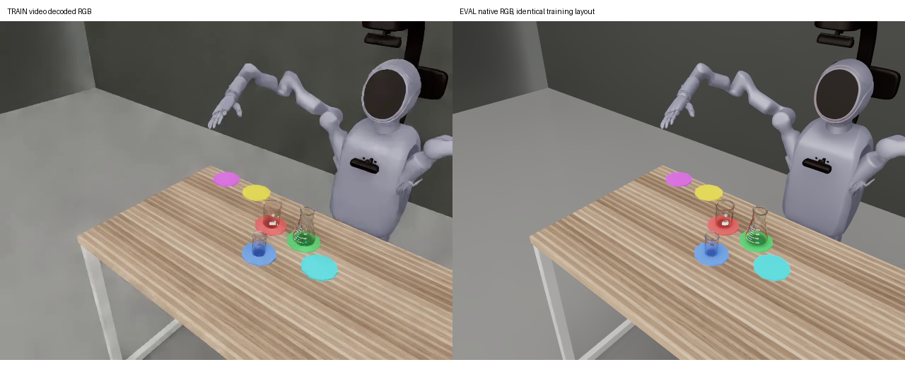

# 五任务 SafeLab-Eval-v1 管线诊断

更新：2026-11-03 10:30 UTC。全量评测继续暂停；以下均为诊断，不能计入正式成功率。

## 调度与资源

task5-all、task5-grasp-attach、task5-ours-aligned-weak（#17）三个旧矩阵已永久冻结后续派发，原三个4卡低优任务均已取消并核对副本终态，释放12卡。历史验收结果保留，标记“阶段 A 部分完成、全0；管线待查，不计正式成绩”。原21000条目标已被新协议取代，不能把剩余缺口继续派发。

目前唯一低优诊断任务为4卡。GPU0测试N1×5，GPU1测试N4×2，其余两卡的14项训练输入对照已结束，暂时空闲；此任务最小规格为4卡，不能单独释放其中两卡。11:30前收尾并释放，最迟不超过N4诊断硬截止11:49 UTC。不再增加低优卡。10:10采样：GPU0约38.9GB、47%；GPU1约76.3GB、58%；GPU2/3均0%。这些是采样值，不是全程均值，也未达到满载目标。

新版正式阶段A/B尚未启动。通过四项准入后，阶段A只运行seed0、h4/h8、原始接触、同100场景、正反各50交错；不新增h30。阶段B和附着按SafeLab-Eval-v1门槛执行。

## 已通过的管线检查

- 取pos1cm训练episode 0/2正向、1/3反向；每条分别回放原120Hz录制目标和current_row标签的15Hz线性插值，**8/8通过原五阶段物理验收**，135888次控制写入检查通过。这是专家回放，不是模型成功率。
- 训练与评测均为50/50正反布局，物体/垫子偏移范围为±1cm；核对资产、障碍物、物体尺寸、底部偏移、桌面及相机配置。具体四条训练布局的回放通过，排除了这一样本上的不可解场景。
- 五任务使用**current_row**，状态为**lerobot_v21_state13**。每个模型加载交付清单指定的pos1cm统计文件及校验和，未混用fixed统计。
- pos1cm源码与当前运行均在正确的第8个物理步渲染；已核实7步RGB滞后修复生效。
- 实际训练路径从SafeLab适配器进入float CHW双线性Resize+抗锯齿，训练有颜色增强；诊断保留同Resize及原Qwen处理器，禁用随机颜色增强。未沿用SDK默认PIL双三次。
- weak/ours实际训练缓存中的视频名虽然叫head_camera，但元数据明确映射第三人称；前两episode的前360帧与发布数据逐像素相同，整条q13/action也相同。没有凭文件别名认定相机错用。

## 开环拟合

每份权重各用本身训练数据的两条360帧连续前缀，只覆盖第一个子任务。h8、8次去噪、预测30步；逐帧提供真实RGB、q13和训练指令。以下是时间集成动作的arm7 RMSE（弧度），不是任务成功率，也不能直接等同训练的扩散/流匹配loss。

|权重|两条训练前缀RMSE|
|---|---|
|old30|0.05498/0.04218|
|new20|0.04996/0.03731|
|new30|0.03372/0.02486|
|weak20|0.04960/0.03928|
|weak30|0.03139/0.03152|
|ours30|0.03523/0.03802|
|oursalignedweak30|0.03047/0.02692|

这组样本中pos1cm拟合没有普遍差于fixed，不能据此把全部失败归为“没有收敛”；也不能由两个前缀证明全数据拟合正常。

## 已确认的视觉影响，尚未定位完整根因

在四条专家回放的0/25/50/75/100%处比对视频解码帧，训练/评测RGB MAE为**2.57–3.43/255**。相机位姿及内参一致，画面主要呈现纹理、清晰度和噪声差异。

对weak30固定q13、指令、历史和随机数进行A/A/C/C/B/B/A：A为真实训练RGB，C为同帧PNG解码，B为原生评测RGB。A/A、A/C、B/B和返回A的动作全部位相同；输入未被修改。只换B后首个动作的手臂最大变化0.0506rad（2.90度），手指最大变化0.2916rad，整段chunk最大差0.8028rad（位于手指）。相对训练动作的全13维RMSE由0.01989升到0.13397rad。这确认视觉差异能改变动作，不能解释为重置顺序、随机噪声或解码器差异；尚未证明它解释全部闭环失败。

编码试探中，按原采集默认质量对应的H264 CRF25处理评测图，动作RMSE降到0.06026rad，但像素MAE反而增大，且仍高于训练输入。简单模糊未恢复拟合。该结果只支持编码/渲染风格敏感这一候选，**不是已验证修复**，不会按单帧挑参数后直接放量。

五段phase0视频分别发现：放置偏移3.27cm超出2.5cm门槛、碰倒非目标物、抓空、提起后偏离目标垫、未抓起。首条指令正确，手臂均在运动。没有证据支持统一放宽完成判定。

## 历史阶段A锚点（全部排除正式成绩）

下表只摘录原矩阵seed0、原始接触、h4/h8；历史全程成功均为0。此处seed0指原矩阵第一轮，保留原噪声种子定义；不冒充新版协议的固定推理seed0。

|模型|步数|历史已验收n|停在阶段0|平均完成阶段数|
|---|---:|---:|---:|---:|
|old30|4|100|32|1.25|
|old30|8|100|39|1.06|
|new20|4|100|95|0.05|
|new20|8|100|95|0.05|
|new30|4|100|94|0.06|
|new30|8|100|97|0.03|
|weak20|4|100|100|0.0|
|weak20|8|100|100|0.0|
|weak30|4|100|100|0.0|
|weak30|8|100|100|0.0|
|ours30|4|100|100|0.0|
|ours30|8|100|99|0.01|
|oursalignedweak30|4|47|46|0.0213|
|oursalignedweak30|8|48|48|0.0|

## 独立执行器后端

[接入说明与边界](task5-policy-process-backend-v1.md)。固定输入完整策略吞吐提升1.55–1.56倍，动作与语义等价。48条物理试批因共享主机内存保护终止：12条闭环、4条中断、32条未派发。已核对自有进程清理，其他任务未停止。中断属于基础设施未知，不能记作模型失败；后端尚未通过48条放量验收，不切换正式运行。

## N4收尾状态

新420帧回放共3360物理tick：N1重复的q13位相同；N4各环境的实际PhysX位置、速度目标与N1位相同，但实际q13差异最大0.00209rad，不能宣称物理轨迹逐tick相同。第0/50帧N1/N4图像差0.35–0.39/255，满足图像门槛。

邻居灯光0→4倍后图像差0.030–0.038/255，但当前私有渲染代理不复制动态灯光，缺少光照变化进入渲染器的正对照，因此不将其列为完整准入通过。之前有限样本N4吞吐为N1×5的0.741倍；新的同型号GPU配对吞吐对照仍在进行。N4目前不准入，正式评测保持N1×k多进程并行。

## 下一步与停止条件

继续以CPU/单卡定位视觉差异的具体来源，补独立样本、多进度帧验证，避免只对一个训练首帧拟合。修复证据成立后才运行20条h8闭环冒烟（正反各10）；若至少18条停在阶段0，立即停止排查，不派发阶段A/B。原物理验收门槛保持不变。
